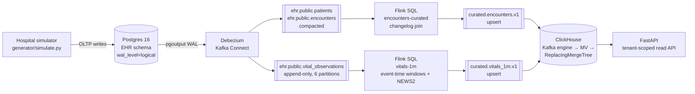

# clinical-stream-pipeline

A streaming data platform for hospital data. Changes committed to an EHR-style Postgres database are captured from the WAL by Debezium, streamed through Kafka, transformed and scored by Apache Flink, and served from ClickHouse to a FastAPI read API. A patient whose vital signs are deteriorating raises an early-warning alert within about a minute of the reading.

Everything runs locally with `docker compose`, and every stage is checked automatically. A smoke gate recomputes each output window from the source database and compares the two. A benchmark measures freshness against the SLO in the data contract.

> **Synthetic data only.** The simulator generates random patients and vitals, and nothing here contains PHI. The early-warning score is a simplified NEWS2-style score for demonstration and is **not for clinical use**.

## Architecture



| Stage | What it does | Key decisions |
|---|---|---|
| **Source**: Postgres | EHR-style schema: `patients`, `encounters`, `vital_observations`. Each hospital is a tenant. | `REPLICA IDENTITY FULL` on mutable tables so updates carry before-images. `vital_observations` is append-only by contract. |
| **CDC**: Debezium | Snapshot followed by streaming log-based capture through `pgoutput` and an explicit publication. | No auto-created publication or topics. A heartbeat stops WAL from building up while tables are quiet. |
| **Transport**: Kafka (KRaft) | Raw CDC topics and curated topics. | Topics are created explicitly ([docs/topics.md](docs/topics.md)). Dimension changelogs are compacted, the fact stream uses time-based retention, and keys put the tenant first. |
| **Processing**: Flink 1.19 SQL | `encounters-curated` joins two changelogs into an upsert stream. `vitals-1m` computes 1-minute event-time tumbling windows and the early-warning score. | RocksDB incremental checkpoints every 10 s, exponential-delay restarts, state TTL on the join, source idle timeout so watermarks keep moving. |
| **Serving**: ClickHouse 24.8 | Kafka engine table, then a materialized view, then a `ReplacingMergeTree` for each curated topic. | `ORDER BY (tenant_id, …)` so a tenant filter prunes data. Reads use `FINAL`. |
| **API**: FastAPI | Census, encounters, vitals history and alerts. | The `X-Tenant-ID` header is required and every query is parameterized. |

## Quick start

Requirements: Docker with Compose v2, Python 3.10+, `make`.

```bash
make install       # Python package + dev tools (use a virtualenv)
make pipeline      # start the stack, register the CDC connector, submit the Flink jobs
make simulate      # 5 minutes of synthetic hospital activity (3 hospitals)
```

Then:

```bash
curl -H 'X-Tenant-ID: H002' localhost:8000/v1/census
curl -H 'X-Tenant-ID: H002' 'localhost:8000/v1/alerts?min_score=5'
open http://localhost:8000/docs     # OpenAPI
open http://localhost:8081          # Flink UI
```

If port 8000 is already taken, use `API_PORT=8800 make up`.

## Validation: proving it before shipping

| Gate | Command | What it proves |
|---|---|---|
| Unit and contract tests | `make test` | The scoring logic is correct at every threshold. The early-warning thresholds in Flink SQL match the Python reference implementation (the SQL is parsed). The Flink sink DDL and the ClickHouse consumer tables match each contract field for field, in the same order and with the same keys. API tenant scoping and input validation work. |
| End-to-end smoke gate | `make smoke` | Runs the simulator on isolated tenants, then checks four things against Postgres. **Completeness:** every encounter's latest state reaches ClickHouse. **Correctness:** every closed window matches an independent SQL recomputation of count, averages, min and max. **Scoring:** Flink's score equals the reference implementation. **Contracts:** records on both curated topics validate against [contracts/](contracts). |
| Freshness benchmark | `make bench` | p50 and p95 time from a committed Postgres `UPDATE` to the new version being queryable in ClickHouse. The command fails if the contract SLO (p95 < 15 s) is breached. |

Results measured on a single laptop-class host running the full compose stack:

| Check | Result |
|---|---|
| Unit and contract tests | 48 passed |
| Smoke gate | 5 passed (about 3.5 min) |
| Smoke gate with the Flink TaskManager **killed mid-run** | 5 passed. Both jobs restored from their latest checkpoint and every window still matched the source exactly. |
| CDC freshness (30 samples) | p50 **1.0 s**, p95 **2.5 s** |
| Stateful job upgrade (`scripts/upgrade_job.sh`) | Stop-with-savepoint, then resubmit. The job was confirmed restored from the savepoint. |

## Data contracts

The curated topics are the interface between this pipeline and the teams that consume it. Each topic has a JSON Schema contract in [contracts/](contracts) that defines:

- the fields, types and enums, with `additionalProperties: false`
- the key (`x-key`) and its semantics (`x-semantics: upsert`)
- a freshness SLO (`x-freshness-slo`)

Contract tests fail the build if the producer or the consumer drifts from the contract. See [contracts/README.md](contracts/README.md) for the versioning and change policy.

## Operations

Runbooks are in [docs/runbooks/](docs/runbooks):

- [CDC connector](docs/runbooks/cdc-connector.md): connector failures, replication slot lag, re-snapshotting
- [Flink jobs](docs/runbooks/flink-jobs.md): checkpoints, failure recovery, stateful upgrades, stuck watermarks
- [ClickHouse serving](docs/runbooks/clickhouse-serving.md): consumer lag, broken messages, deduplication
- [Onboarding a new data domain](docs/runbooks/onboarding-a-domain.md): step-by-step checklist

## Repository layout

```
postgres/init.sql            source EHR schema + publication
connect/ehr-postgres.json    Debezium connector config (PUT-idempotent)
flink/jobs/*.sql             Flink SQL jobs (one INSERT = one job)
clickhouse/init.sql          serving tables: Kafka engine -> MV -> ReplacingMergeTree
contracts/*.json             JSON Schema data contracts for curated topics
pipeline_tools/              shared Python: settings, contract validation, NEWS2 reference
generator/simulate.py        synthetic multi-tenant hospital simulator
api/app.py                   FastAPI read API
scripts/                     topic creation, connector registration, job submit/upgrade, benchmark
tests/unit                   fast tests, no infrastructure needed
tests/smoke                  end-to-end gate against the running stack
docs/                        topic design, runbooks
```

## Tech stack

Python 3.10+ · PostgreSQL 16 · Debezium 2.7 · Apache Kafka 3.8 (KRaft) · Apache Flink 1.19 (SQL, RocksDB state) · ClickHouse 24.8 · FastAPI · Docker Compose · pytest · GitHub Actions
